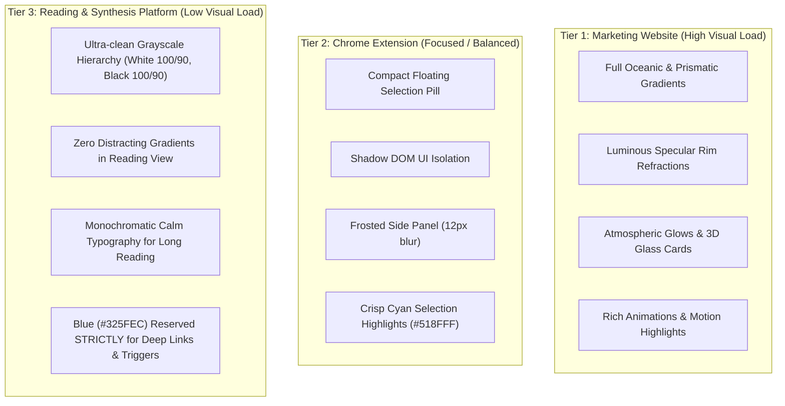

# Researchie Design System Specification

**Version:** 2.0.0  
**Status:** Canonical Brand & UI Token Master  
**Target Environments:** Marketing Website · Chrome Extension (Manifest V3) · Web Platform (Reading & Synthesis Workspace)  

---

## 1. Brand Philosophy & Core Visual Metaphor

Researchie's design system is built on **clarity, confidence, forward momentum, and optical depth**. 

Web research is messy—hundreds of tabs, broken formatting, lost contexts. Researchie transforms this chaos into a focused, crystal-clear stream of knowledge. The visual metaphor uses **luminous light refractions, deep obsidian voids, and crisp optical glass**: light represents captured insight and focus cutting through the dark noise of information overload.

---

## 2. Master Color Architecture

### 2.1 Core Brand Colors (Observed Reference Palette)

```
┌────────────────────────────────────────────────────────────────────────┐
│ CORE BRAND PALETTE                                                     │
├──────────────┬──────────────┬──────────────┬──────────────┬────────────┤
│ Black        │ Deep Navy    │ Royal Blue   │ Electric Cyan│ Pure Light │
│ #081116      │ #0A0E15      │ #325FEC      │ #518FFF      │ #FFFFFF    │
│ RGB(8,17,22) │ RGB(10,14,21)│RGB(50,95,236)│RGB(81,143,255│RGB(255,255)│
└──────────────┴──────────────┴──────────────┴──────────────┴────────────┘
```

- **Obsidian Black (`#081116`)**: The deepest canvas void. Grounds marketing hero backdrops and immersive dark modes.
- **Midnight Black (`#0A0E15`)**: Base dark surface (Black 100) for platform dark mode.
- **Royal Blue (`#325FEC`)**: Primary brand identity, solid button fills, and structural brand anchors.
- **Electric Cyan Blue (`#518FFF`)**: Specular edge refractions, active highlights, glowing focal points, and live text citations.
- **Pure White (`#FFFFFF`)**: High-contrast text on dark surfaces and pure clean card backgrounds in light mode.

---

### 2.2 Dual-Mode Grayscale Matrix (Systematic Slate Grays)

Extracted directly from the precision `uxdam` dual-ramp system:

#### Light Mode Grayscale (White Ramp)
| Token Name | Hex Code | RGB | Systematic UI Role |
| :--- | :--- | :--- | :--- |
| **White 100** | `#FFFFFF` | `255, 255, 255` | Primary Card Surfaces, Modal Backgrounds, Elevated Sheets |
| **White 90** | `#F0F1F5` | `240, 241, 245` | Main Application Canvas, Page Surface, Extension Panel BG |
| **White 80** | `#E0E4EB` | `224, 228, 235` | Secondary Surfaces, Input Fields, Inactive Filter Tabs |
| **White 70** | `#D1D6E0` | `209, 214, 224` | Default Component Borders, Table Dividers, Stroke Lines |
| **White 60** | `#BFC6D4` | `191, 198, 212` | Hover Borders, Subtle Icons, Disabled Input Containers |

#### Dark Mode Grayscale (Black Ramp)
| Token Name | Hex Code | RGB | Systematic UI Role |
| :--- | :--- | :--- | :--- |
| **Black 100** | `#0A0E15` | `10, 14, 21` | Main Dark Canvas, Side Panel Deep Background |
| **Black 90** | `#202531` | `32, 37, 49` | Primary Dark Card Surfaces, Floating Command Bars |
| **Black 80** | `#37404F` | `55, 64, 79` | Secondary Dark Cards, Active Row Highlights, Input BG |
| **Black 70** | `#4E5766` | `78, 87, 102` | Dark Component Borders, Subtle Separators, Keylines |
| **Black 60** | `#667085` | `102, 112, 133` | Muted Dark Text, Inactive Icons, Secondary Metadata |

---

### 2.3 Semantic & Functional Color Tokens

| Semantic Role | Light Mode Hex | Dark Mode Hex | Assigned Product Job |
| :--- | :--- | :--- | :--- |
| **Primary Action** | `#325FEC` | `#518FFF` | "Save to Project", "Synthesize", Primary CTAs |
| **Citation / Deep Link** | `#1D4ED8` | `#60A5FA` | Exact sentence scroll links (`#:~:text=`), Verified URLs |
| **AI / Synthesis Accent**| `#7C3AED` | `#A78BFA` | In-page AI Summary, Q&A answers, Synthesis draft badges |
| **DOM Block Highlight** | `#0284C7` | `#38BDF8` | Element picker bounding box, CSS Selector badges |
| **Success / Synced** | `#059669` | `#34D399` | Offline sync complete, quote captured confirmation |
| **Warning / Attention** | `#D97706` | `#FBBF24` | Rate limit warnings, unsaved cache alerts |
| **Destructive / Error** | `#DC2626` | `#F87171` | Delete note, remove project, capture failure |

---

## 3. Optical Mechanisms: Gradients, Blurs, Refractions & Grids

### 3.1 Custom & Complex Gradients

1. **Oceanic Momentum Gradient (Brand Hero & Visual Identity)**
   ```css
   background: linear-gradient(135deg, #081116 0%, #0E223D 45%, #1D4ED8 80%, #518FFF 100%);
   ```
2. **Kinetic Prismatic Ray (Feature Spotlight & Marketing Cards)**
   ```css
   background: radial-gradient(circle at 50% 0%, rgba(81, 143, 255, 0.35) 0%, rgba(50, 95, 236, 0.15) 50%, rgba(8, 17, 22, 0) 100%);
   ```
3. **Subtle Light Mode Mesh (Clean Platform Reading Accent)**
   ```css
   background: linear-gradient(180deg, #FFFFFF 0%, #F0F1F5 100%);
   ```
4. **Frosted Dark Glass Gradient (Floating Bars & Extension Pills)**
   ```css
   background: linear-gradient(135deg, rgba(32, 37, 49, 0.85) 0%, rgba(10, 14, 21, 0.95) 100%);
   ```

---

### 3.2 Light Refraction & Specular Edge Glows

The signature Researchie visual depth is created by **specular refraction rim lighting**:

- **Dark Luminous Refraction Card (Marketing / Featured Items):**
  ```css
  background: rgba(14, 25, 45, 0.65);
  backdrop-filter: blur(16px);
  -webkit-backdrop-filter: blur(16px);
  border: 1px solid rgba(81, 143, 255, 0.4);
  box-shadow: 
    inset 0 1px 1px 0 rgba(255, 255, 255, 0.5),
    inset 0 0 20px 0 rgba(81, 143, 255, 0.2),
    0 12px 32px -4px rgba(8, 17, 22, 0.5),
    0 0 16px -2px rgba(81, 143, 255, 0.25);
  ```

- **Light Minimal Refraction Card (Platform Light Mode):**
  ```css
  background: #FFFFFF;
  border: 1px solid #D1D6E0;
  box-shadow: 
    0 1px 3px 0 rgba(10, 14, 21, 0.04),
    0 6px 16px -2px rgba(50, 95, 236, 0.05);
  ```

---

### 3.3 Blur Mechanisms & Depths

- **Subtle Glass (`backdrop-blur-sm` / 4px):** In-page tooltip pills, small action menus.
- **Standard Frosted Glass (`backdrop-blur-md` / 12px–16px):** Chrome Extension Side Panel, floating project switcher, sticky navigation.
- **Deep Prismatic Blur (`backdrop-blur-xl` / 24px–32px):** Marketing feature modals, pricing tier cards.
- **Atmospheric Dispersion (`blur-3xl` / 64px–96px):** Background ambient light orbs behind key data visualizations.

---

### 3.4 Grid & Architectural Alignment

- **Grid Lines:** Clean 32px / 40px orthogonal grid.
- **Grid Stroke (Dark Mode):** `rgba(81, 143, 255, 0.08)` (1px solid).
- **Grid Stroke (Light Mode):** `rgba(209, 214, 224, 0.60)` (1px solid).
- **Alignment:** 8pt spatial baseline. All margins, paddings, and card gaps snap strictly to `4px`, `8px`, `12px`, `16px`, `24px`, `32px`, `48px`.

---

## 4. Typography & Type Scales

**Canonical Font Hierarchy:**
- **Headers & Display:** `JetBrains Mono` (Weights: 600, 700, 800)
- **Body, UI & Reading Text:** `Figtree` (Weights: 400, 500, 600)
- **Code, Selectors, Citations & Timestamps:** `JetBrains Mono` (Weights: 400, 500, 600)
- *(All other fonts like Plus Jakarta Sans or Inter are strictly prohibited)*

### Systematic Type Ramp

| Token | Size / Line Height | Weight | Letter Spacing | Applied Location | Font Family |
| :--- | :--- | :--- | :--- | :--- | :--- |
| **Display 2XL** | 44px / 52px | Extrabold (800) | `-0.03em` | Marketing Hero Headline | `JetBrains Mono` |
| **Display XL** | 32px / 40px | Extrabold (800) | `-0.025em`| Workspace & Project View Header | `JetBrains Mono` |
| **Heading LG** | 22px / 28px | Bold (700) | `-0.02em` | Section Titles, Modal Headers | `JetBrains Mono` |
| **Heading MD** | 17px / 24px | Bold (700) | `-0.015em`| Note Card Titles, Side Panel Topics | `JetBrains Mono` |
| **Body LG** | 15px / 22px | Medium (500) | `-0.01em` | AI Summary paragraph, Long-form synthesis | `Figtree` |
| **Body Regular**| 13.5px / 20px | Medium (500) | `normal` | Captured text quotes, Timeline card body | `Figtree` |
| **Caption / Tag**| 11.5px / 16px| Bold (700) | `+0.04em` (UPPER)| Project tags, Status pills, Category tags | `Figtree` / `JetBrains Mono` |
| **Code / Selector**| 11.5px / 16px| Medium (500) | `normal` (Mono) | DOM Selectors (`div.pricing`), OCR strings | `JetBrains Mono` |

---

## 5. Three-Tier Distribution Matrix: Where What Applies

A critical architectural rule of Researchie: **Visual intensity is inversely proportional to reading density.**



### Detailed Distribution Breakdown:

1. **Marketing Website (`/web/landing`)**:
   - **Visual Load:** **High (100%)**.
   - **Allowed:** Rich radial gradients, kinetic light rays, glowing specular border refractions, deep atmospheric glassmorphism, animated cards.
   - **Goal:** Emotionally captivating, conveying speed, AI intelligence, and future-forward momentum.

2. **Chrome Extension Plugin (`/extension`)**:
   - **Visual Load:** **Focused / Moderate (40%)**.
   - **Allowed:** Lightweight frosted pills (`backdrop-blur-md`), sharp 1px borders, crisp electric cyan accents on hover/active, high-contrast typography.
   - **Disallowed:** Heavy background gradients, large ambient blur blobs that clash with host website content.
   - **Goal:** Instant recognition without obstructing the user's reading flow on the host page.

3. **Web Platform Reading & Synthesis Workspace (`/app`)**:
   - **Visual Load:** **Very Low / High Readability (15%)**.
   - **Allowed:** Systematic grayscale palette (`White 100/90/80` or `Black 100/90/80`), structured 16px rounded cards, subtle border elevations. Electric blue is used exclusively for actionable triggers (e.g. `Jump to text`, `Synthesize`, `Copy citation`).
   - **Disallowed:** Multi-colored decorative cards, persistent glowing refractions, distracting background patterns.
   - **Goal:** Maximum cognitive clarity, eye comfort during multi-hour analytical research, perfect typographic hierarchy.

---

## 6. Component System & States

### 6.1 Note Card Anatomy (Platform Stream)
- **Container:** `rounded-2xl` (16px), `bg-white` (Light) / `bg-black-90` (Dark).
- **Border:** `1px solid #D1D6E0` (Light) / `1px solid #37404F` (Dark).
- **Header:** 
  - Left: Project Pill Tag (`10.5px`, bold, uppercase, `bg-blue-50 text-blue-700` / `bg-blue-950 text-blue-300`) + Source Domain.
  - Right: Action menu (`...`) & Note Type Badge.
- **Content:** 
  - Text Quote: `13.5px`, font-medium, leading-relaxed, surrounded by subtle quotation accents.
  - DOM Block: Rendered clean HTML preview with interactive toggle to raw HTML/JSON.
  - Image OCR: Thumbnail preview with extracted selectable text drawer.
- **Footer:** Deep Citation link button (`Jump to exact text` with `ExternalLink` icon), Copy quote button, Timestamp.

### 6.2 Component States
| State | Light Mode Visual Treatment | Dark Mode Visual Treatment |
| :--- | :--- | :--- |
| **Default** | Surface White 100, Border White 70 (`#D1D6E0`), Ink `#0F172A` | Surface Black 90, Border Black 80 (`#37404F`), Ink `#F0F1F5` |
| **Hover** | Border `#325FEC`, Shadow `0 6px 20px rgba(50,95,236,0.08)`, `-translate-y-0.5` | Border `#518FFF`, Shadow `0 6px 20px rgba(81,143,255,0.15)`, `-translate-y-0.5` |
| **Active / Pressed** | Scale `0.99`, Background White 80 (`#E0E4EB`) | Scale `0.99`, Background Black 80 (`#37404F`) |
| **Focused** | Ring `2px solid #325FEC` with `2px` offset | Ring `2px solid #518FFF` with `2px` offset |
| **Disabled** | Opacity `0.40`, Cursor `not-allowed`, Grayscale filter | Opacity `0.35`, Cursor `not-allowed` |

---

## 7. Generation & Implementation Rules

1. Never apply marketing refraction glows or saturated radial gradients inside the **Platform Reading Timeline**.
2. Never invent a new hex color value outside of the 4 Brand Primaries, the 10 Grayscale steps (`White 60-100`, `Black 60-100`), or the 5 semantic roles.
3. Every captured quote card MUST include the exact scroll link target (`#:~:text=`) with the `#325FEC` / `#518FFF` citation trigger.
4. Keep all interactive touch & click targets at a minimum of `32px` (micro actions) to `40px` (primary actions).
