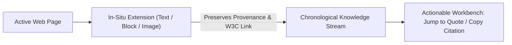

# Researchie — Portfolio Case Study Foundations

## 1. Problem Space & User Friction
Researchers, designers, and analysts lose 30–40% of their working time to the **"Tab Hoarding & Broken Context"** loop:
- Opening dozens of browser tabs during teardowns and audits.
- Copy-pasting into notes apps that strip table layouts into unreadable plain text.
- Losing citations: returning days later unable to find which paper or company stated a metric.

---

## 2. The Solution Mechanics

### 1. In-Situ Ingestion
Researchers clip text highlights (<kbd>Alt+S</kbd>), DOM blocks (<kbd>Alt+B</kbd>), or screen areas (<kbd>Alt+C</kbd>) directly inside their active tab with zero context switching.

### 2. Deep Provenance & W3C Links
Every quote links back with a standard `#:~:text=` hash. Anyone clicking the link opens the original page scrolled and highlighted directly to that quote.

### 3. Visual Container Preservation
Rather than flattening comparison matrices or pricing grids into unformatted strings, Researchie extracts sanitized HTML, maintaining the visual layout while keeping text selectable.

---

## 3. Case Study: Making Citations Trustworthy (October 2026)

### The problem
A research tool earns trust only if its citations are right. A wrong citation costs the researcher later, and a tool that cries "verify" on every citation teaches people to ignore it. Two things were failing at once. Clips had no reliable citation, and the document assistant sometimes said "not found" for answers that were in the paper while showing page links nobody could confirm.

### The principles we set
1. **Never guess.** A missing field is shown as "not shown", not filled in.
2. **A warning must mean evidence.** It appears only when something the user entered does not match the clip. Missing fields, preprints and web pages are plain notes.
3. **A failed check must not damage what is saved.** A mismatched source is not saved, and Back returns to the original.
4. **An honest failure beats a confident wrong answer.** When the AI service cannot answer, the app says so.
5. **Every link must point to checked text.** Page links come only from quotes verified against the document.

### What we built
- Four ways to a citation that do not require knowing a DOI: the page's own tags, a title search with a pick list, a web-page citation from page facts, and a short form for PDFs with no DOI.
- A passage-level Q&A: each page is split into passages with page numbers and offsets. The model quotes a passage, the app finds the quote in the page, and the link icon opens that page with the passage highlighted.
- A clearer citation box: one box for a DOI, a PMID or a title, a Page · Author · Date line on every citation, and Back only where it leads somewhere.

### What testing taught us
We asked a real open-access paper 18 questions (easy facts, section questions, multi-part questions and three that the paper cannot answer), then repeated the hard ones.

| Step | Result |
| :--- | :--- |
| First run | 13 of 18 passed on our checker. Three of the five misses were the checker being too strict. Two were real: correct answers flagged as unsupported. |
| Cause of the flags | The model's quote was stitched with "...", skipped a sentence, contained a symbol with a hidden accent, or was split by a line-break hyphen. The check required an exact string. |
| After the tolerant matching rules | 12 repeat questions produced 29 citations, none unsupported. An earlier full run passed 18 of 18 with no warnings. |
| Next failure | "What does page 13 say?" answered "not found" under load. The size retry cut the end of the context, and a weaker fallback model gave up. |
| Fix | The retry re-selects the most relevant passages, a "not found" from a fallback model becomes "busy", and the small model is skipped. |

The bigger lesson was that the first symptom ("the AI is wrong") had four different causes: PDF text was never extracted, a matching rule was too strict, a retry dropped the right page, and the free tier ran out. Treating them as one problem would have hidden three of them.

### Honest limits
- Testing used the free Groq allowance for the day (200,000 tokens per model), so the last Q&A settings are verified by unit tests only.
- Several automated browser tests fail because the "most recently viewed" document changed as test files were uploaded. We think this is test-data pollution but have not proved it.
- A wrong paper that shares the clip's title would still be accepted.
- One mistaken click during testing opened a project delete confirmation. It was cancelled and nothing was deleted.

### Outcome
- Library delete, upload and Q&A now behave as described above, with 92 unit tests and a 5-test browser spec for the link icons.
- Still to do: placing the link icon per sentence, one scroll per click, clearing a highlight on outside click, a resizable assistant panel, formatted lines for more source types, and a live Chrome clip test.

---

## 4. Case Study: A Report a Researcher Can Hand In (October 2026)

### The problem
A research tool earns its keep at the moment someone hands work over: to a supervisor, into a draft, to a collaborator. Until now the clips and citations lived inside the app and left only as text. A document had to carry the sources with it, readably, and without quietly changing what the researcher wrote.

### The principles we set
1. **Never change the researcher's text silently.** A missing symbol is a data error, not a styling detail.
2. **Colour carries meaning, and words carry the message.** Each semantic colour has one job, and the colours that fail contrast as small text only colour shapes.
3. **A reader who was not there must understand every line.** The app's own file names are not citations.
4. **Check the thing itself, not a proxy for it.** Read the pages and re-read the file as text.
5. **Keep secrets out of every document, and scan before every push.**

### What we built
- A PDF report from a new tab in the Export dialog: cover, clickable contents, clip cards with sources, numbered bibliography in Vancouver, APA or AMA, and a colour key, in the product's own design system.
- Citation formats around it: APA 7, AMA 11, six Vancouver source types, BibTeX and RIS, with a single citation box (style tabs, live preview, a clear Copied state).
- A warning policy that grew with evidence: Save anyway, a warning when a PDF's own DOI points to a different paper, and an amber box for a retraction.

### What testing taught us
| Step | Result |
| :--- | :--- |
| First real export of a 77-clip project | A clean 69-page PDF. The pages looked right, and the text checks passed. |
| Extra test with scientific symbols | Greek letters, ≥, μ, sub and superscripts and some accented letters were silently missing, and "data‑driven" lost its hyphen because the non-breaking hyphen is not in the font. A "μm" would have printed as "m". |
| Fix | Characters outside the two Latin fonts draw in a fallback font; special hyphens become plain; anything no font has prints as a visible mark and is listed in the dialog first. |
| Real data check, again | The clips from an uploaded PLoS paper printed "journal.pone.0355849 (Page 1)". Now they read "Geng et al. (2026), PLoS One - p. 1" with the DOI in the bibliography. |
| Before the first push | A scan found the real Supabase keys in a planning document. They were removed from every commit, the key was rotated, and the old key was confirmed dead. |
| Browser tests | Two suites failed 4 to 11 times out of 14. The cause was that they never chose a project. After the fix: 28 of 28 over two repeats. |

The pattern in every row was the same: the check that passed (text found, a test green) was a stand-in for the thing that mattered (the researcher's words intact, a reader's understanding, a safe repository). Each problem was found only by looking at the real output.

### Honest limits
- The contents page has no page numbers, and every citation style uses numbered references (APA author-date is not done).
- Scripts the fallback font lacks, such as Chinese, print as a replacement mark.
- AMA covers journal articles and web pages only, because no primary example exists for the rest.
- A PDF cannot force a link into a new tab; the report tells the reader to Ctrl-click.
- Two local branches were not scrubbed and must not be pushed as they are.

### Outcome
- A researcher can export a project to a PDF with working links, the right citations and flagged sources, and see before downloading what cannot be drawn.
- 159 unit tests, 13 browser specs, a production build that passes, and the heavy PDF code loads only on export.
- Still to do: AMA forms for four more types, APA author-date citations, page numbers on the contents page, and the next features from the plan: shared projects, an offline queue and two-way Notion sync.

---

## 5. Case Study: From Collected Papers to a Checked Draft (October 2026)

### The problem
Researchers collect papers and their own notes, then write elsewhere. They can not see what their paper will look like once an editing team formats it (usually paid), and they lose motivation. The ask: a live paper preview, understanding and motivation only, never a claim to replace journal formatting.

### The constraint that shaped everything
The free AI limit can not match NotebookLM at finding answers across many papers. So the platform does not try. It takes what NotebookLM or Zotero already produced (by paste or file), and adds what they do not: structure, citations in the style the researcher picks, and checks.

### What was built
- A paper outline (template, parts, drag clips in) and a preview that looks like a published page, with a banner and a printed-page footer saying it is only a preview.
- Harvard and numbered citations that switch live from the same data.
- Three kinds of clip (Quote, AI summary, Mine); only a Quote can be quoted or cited.
- A paste box and an RIS/BibTeX import that turn text into Quotes only when it is word for word in the researcher's PDF.
- An AI draft that uses only one section's clips, then fixed checks on every sentence; a checklist that gates "done".
- Equations (KaTeX), numbered figures and tables, a PDF export, and an editor for the researcher's own text with citations inserted from a list.

### What the real model taught
The first real draft blended the researcher's own pilot result with a cited paper's finding in one sentence, so the citation credited the paper with the pilot result. Tests with a pretend model had not shown it. A new check and a prompt rule came from one real call. The lesson: the checks are only as good as the failures seen, so each real failure becomes a check.

### Decisions the owner made
Save the outline in account preferences (no migration), one outline per person; attach imported references to the matching PDF or clip. Everything else was proposed and accepted. Full list with reasons, limits and what was rejected: `docs/PAPER_WRITING_DECISIONS.md`.

### Outcome
- A researcher can go from clips to a cited, checked, previewable section in one place, and is told exactly what is unsourced, misquoted, copied, retracted or borrowed.
- Four commits, 56 files, about 7,100 lines added; about 480 unit tests in the repository and 13 browser tests for this feature.

### What is not proven
Nothing was tried signed in on the live site; no outside researcher has used it; the style wording was checked against machine-readable style files, not the books. A reworded sentence that changes a clip's meaning passes every check. The feature should be described as "built and tested locally", not "shipped".
