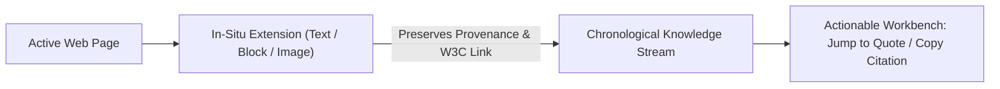

# Researchie — Portfolio Case Study Foundations

## 1. Problem Space & User Friction
Researchers, designers, and analysts lose 30–40% of their working time to the **"Tab Hoarding & Broken Context"** loop:
- Opening dozens of browser tabs during teardowns and audits.
- Copy-pasting into notes apps that strip table layouts into unreadable plain text.
- Losing citations: returning days later unable to find which paper or company stated a metric.

---

## 2. The Solution Mechanics

### 1. In-Situ Ingestion
Researchers clip text highlights (<kbd>Alt+S</kbd>), DOM blocks (<kbd>Alt+B</kbd>), or screen areas (<kbd>Alt+C</kbd>) directly inside their active tab with zero context switching.

### 2. Deep Provenance & W3C Links
Every quote links back with a standard `#:~:text=` hash. Anyone clicking the link opens the original page scrolled and highlighted directly to that quote.

### 3. Visual Container Preservation
Rather than flattening comparison matrices or pricing grids into unformatted strings, Researchie extracts sanitized HTML, maintaining the visual layout while keeping text selectable.
