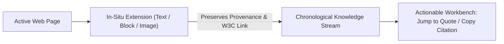

# Researchie — Portfolio Case Study Foundations

## 1. Problem Space & User Friction
Researchers, designers, and analysts lose 30–40% of their working time to the **"Tab Hoarding & Broken Context"** loop:
- Opening dozens of browser tabs during teardowns and audits.
- Copy-pasting into notes apps that strip table layouts into unreadable plain text.
- Losing citations: returning days later unable to find which paper or company stated a metric.

---

## 2. The Solution Mechanics

### 1. In-Situ Ingestion
Researchers clip text highlights (<kbd>Alt+S</kbd>), DOM blocks (<kbd>Alt+B</kbd>), or screen areas (<kbd>Alt+C</kbd>) directly inside their active tab with zero context switching.

### 2. Deep Provenance & W3C Links
Every quote links back with a standard `#:~:text=` hash. Anyone clicking the link opens the original page scrolled and highlighted directly to that quote.

### 3. Visual Container Preservation
Rather than flattening comparison matrices or pricing grids into unformatted strings, Researchie extracts sanitized HTML, maintaining the visual layout while keeping text selectable.

---

## 3. Case Study: Making Citations Trustworthy (October 2026)

### The problem
A research tool earns trust only if its citations are right. A wrong citation costs the researcher later, and a tool that cries "verify" on every citation teaches people to ignore it. Two things were failing at once. Clips had no reliable citation, and the document assistant sometimes said "not found" for answers that were in the paper while showing page links nobody could confirm.

### The principles we set
1. **Never guess.** A missing field is shown as "not shown", not filled in.
2. **A warning must mean evidence.** It appears only when something the user entered does not match the clip. Missing fields, preprints and web pages are plain notes.
3. **A failed check must not damage what is saved.** A mismatched source is not saved, and Back returns to the original.
4. **An honest failure beats a confident wrong answer.** When the AI service cannot answer, the app says so.
5. **Every link must point to checked text.** Page links come only from quotes verified against the document.

### What we built
- Four ways to a citation that do not require knowing a DOI: the page's own tags, a title search with a pick list, a web-page citation from page facts, and a short form for PDFs with no DOI.
- A passage-level Q&A: each page is split into passages with page numbers and offsets. The model quotes a passage, the app finds the quote in the page, and the link icon opens that page with the passage highlighted.
- A clearer citation box: one box for a DOI, a PMID or a title, a Page · Author · Date line on every citation, and Back only where it leads somewhere.

### What testing taught us
We asked a real open-access paper 18 questions (easy facts, section questions, multi-part questions and three that the paper cannot answer), then repeated the hard ones.

| Step | Result |
| :--- | :--- |
| First run | 13 of 18 passed on our checker. Three of the five misses were the checker being too strict. Two were real: correct answers flagged as unsupported. |
| Cause of the flags | The model's quote was stitched with "...", skipped a sentence, contained a symbol with a hidden accent, or was split by a line-break hyphen. The check required an exact string. |
| After the tolerant matching rules | 12 repeat questions produced 29 citations, none unsupported. An earlier full run passed 18 of 18 with no warnings. |
| Next failure | "What does page 13 say?" answered "not found" under load. The size retry cut the end of the context, and a weaker fallback model gave up. |
| Fix | The retry re-selects the most relevant passages, a "not found" from a fallback model becomes "busy", and the small model is skipped. |

The bigger lesson was that the first symptom ("the AI is wrong") had four different causes: PDF text was never extracted, a matching rule was too strict, a retry dropped the right page, and the free tier ran out. Treating them as one problem would have hidden three of them.

### Honest limits
- Testing used the free Groq allowance for the day (200,000 tokens per model), so the last Q&A settings are verified by unit tests only.
- Several automated browser tests fail because the "most recently viewed" document changed as test files were uploaded. We think this is test-data pollution but have not proved it.
- A wrong paper that shares the clip's title would still be accepted.
- One mistaken click during testing opened a project delete confirmation. It was cancelled and nothing was deleted.

### Outcome
- Library delete, upload and Q&A now behave as described above, with 92 unit tests and a 5-test browser spec for the link icons.
- Still to do: placing the link icon per sentence, one scroll per click, clearing a highlight on outside click, a resizable assistant panel, formatted lines for more source types, and a live Chrome clip test.
