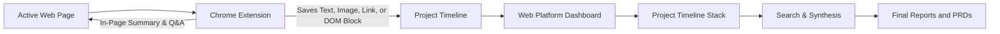
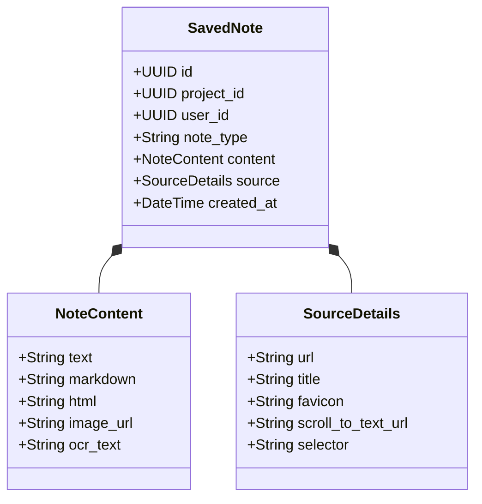

# Product requirements document
## Project: Researchie (Web research extension and project organizer)

Document version: 1.1.0  
Status: Draft for review  
Target release: Q4 2026 – Q1 2027  

## 1. Summary

People who do heavy online research spend a lot of time copying text, saving screenshots, and losing track of what they found across dozens of browser tabs. Standard bookmarks do not save the actual text or visual context, and copying into apps like Google Docs or Notion often breaks tables and formatting. When researchers need to review their sources later, they waste time trying to find the original page and remember why they saved a quote.

Researchie connects two tools to solve this:
1. A Chrome extension (Manifest V3) that lets users save highlighted text, web links, images, and full layout blocks (such as pricing tables and comparison grids) straight into a project. It also provides a quick page summary and lets users ask questions about the current page using AI.
2. A web application where saved items stack up in a clean timeline. Users can search their saved notes using plain language, trace any quote back to the exact sentence on the source page, and generate summary reports across multiple saved clips.

## 2. How researchers work and where they get stuck

We looked at how people gather research across product design, market analysis, venture capital, and academic work.

### Observed workflows

| Role | Primary task | What they collect | Main problem |
| :--- | :--- | :--- | :--- |
| Product and UX designers | Competitive teardowns, pricing audits, pattern benchmarking | UI components, pricing cards, feature tables | Copying breaks formatting; screenshots are just static pictures that cannot be copied or searched. |
| Market and investment analysts | Industry research, earnings notes, press releases | Data tables, financial metrics, executive statements | Hard to organize quotes from 20 different sources into a clear briefing doc. |
| Academic and tech researchers | Reading papers, technical documentation, specifications | Quotes, citations, formulas, API definitions | Quotes lose their context; users cannot easily jump back to the exact sentence in a 30-page paper. |

### The five stages of web research

Most web research follows five steps:
1. Discovery: Opening 15 to 30 tabs from search results, news feeds, and social posts.
2. Collecting: Copying quotes, saving images, or bookmarking links into a temporary doc.
3. Verification: Checking numbers against a second source and noting key takeaways.
4. Organizing: Grouping scattered notes into themes, timelines, or categories.
5. Writing: Drafting the final summary, PRD, memo, or presentation with citations.

Today, people get stuck between steps 2 and 4. Moving back and forth between browser tabs and note apps breaks concentration, and notes quickly turn into an unorganized mess of text.

## 3. The four note types

When a user saves something, Researchie stores it as one of four note types with full source details:

1. Text note: Highlighted text from the page. Researchie saves the text, author, page title, and creates a browser scroll link (`#:~:text=start,end`). Anyone who clicks that link opens the page scrolled and highlighted directly to that quote.
2. Link note: A saved URL that automatically pulls the page title, preview image, description, and an AI-generated one-sentence summary.
3. Image note: A saved image or screen crop. The system runs optical character recognition (OCR) so any text inside charts or diagrams is fully searchable later.
4. Layout block note: A captured section of the webpage (such as a pricing card or comparison table). The user hovers over the block with an element picker to select it. Researchie stores both a clean HTML version and an image snapshot, keeping the visual layout while leaving the text selectable.

## 4. Common user habits and friction points

### Four user behaviors

1. Tab hoarders: Keep 50 to 200 tabs open across multiple windows as a reminder to read them later, fearing they will lose the link if they close the tab.
2. Copy-paste scramblers: Jump constantly between the browser and a Google Doc or Notion page, pasting unformatted text and broken tables.
3. Context losers: Save a quote or metric, but forget which company or article it came from when writing their report a few days later.
4. Overwhelmed collectors: Collect dozens of bookmarks and notes, but struggle to start writing because their notes are not organized.

### Core problems to solve

1. Lost source context: A quote without a date, author, or URL is hard to cite reliably.
2. Tab switching friction: Switching windows to paste a quote takes 4 to 5 seconds each time and interrupts reading.
3. Broken page formatting: Complex elements like pricing grids, multi-column tables, and spec sheets turn into unreadable text when copied.
4. Forgotten bookmarks: Traditional bookmarks sit in a folder and are rarely opened again.
5. Ineffective search: Standard keyword search misses relevant notes when the user searches for a concept using different words than the author used.
6. Reading long pages without assistance: Reading a 10,000-word document without a quick way to ask specific factual questions slows researchers down.

## 5. Jobs to be done

Core job:
"When I am researching a topic across several websites, I want to capture text, images, and layout blocks into a project without leaving the page, so that I have an organized set of notes ready when I write my report."

Supporting jobs:
- Confirm where a specific data point came from without searching through browser history.
- Share an organized stream of research notes with team members.
- Summarize findings across 15 different articles into a single draft.

## 6. Target users

### 1. Product and UX designers
- What they do: Benchmark competitor websites, pricing models, and onboarding flows.
- Pain point: Screenshots do not preserve text, and regular clippers ruin tables.
- Value from Researchie: The block picker captures pricing and feature tables as styled, selectable components.

### 2. Market and investment analysts
- What they do: Gather market size estimates, founder quotes, and customer reviews across news sites and forums.
- Pain point: Hard to remember which source said what when writing an investment memo.
- Value from Researchie: Every text quote links back to the exact paragraph on the live page, and multi-note summaries help assemble the initial draft.

### 3. Academic and deep-tech researchers
- What they do: Read long preprints, technical standards, and documentation.
- Pain point: Finding a specific benchmark across multiple whitepapers is tedious.
- Value from Researchie: In-page Q&A answers specific questions about long articles directly in the browser.

## 7. Feature specifications

### Chrome extension

#### 1. Selection tools
- Text selection: When the user highlights text, a small popup pill appears with "Save to project" and "Ask AI". Clicking save captures the text, surrounding context, and builds a scroll-to-text link. Keyboard shortcut: `Alt + S`.
- Link saving: Right-click any link or drag it into the extension icon to save the page preview.
- Image saving: Hover over any image to see a "Save image" button, or press `Alt + C` to crop a section of the screen.
- Layout block picker: Click "Inspect block" or press `Alt + B`. Moving the mouse highlights page containers with a light blue outline and tag name (`div.pricing-card`, `table.specs`). Pressing the Up arrow expands selection to the parent element; pressing Down selects the child element. Clicking saves the cleaned HTML and an image snapshot.

#### 2. AI page summary
- Quick summary: Generates a 3-bullet takeaway of the active tab in under 2 seconds.
- Detailed breakdown: Pulls key data points, stated methodology, and main arguments.
- Data table extractor: Finds tables on the page and converts them into markdown format.
- One-click save: Sends the summary directly into the active project timeline.

#### 3. In-page Q&A side panel
- Uses Chrome's native side panel (`chrome.sidePanel`).
- The assistant reads the clean text of the active tab. Users can ask questions like "What sample size was used?" or "What are their enterprise prices?".
- Answers include clickable citation chips that scroll the active tab to the exact sentence.
- Any answer can be saved directly to the project with one click.

#### 4. Project switcher and queue
- A small floating button on the edge of the page shows the current project name.
- Clicking it opens a dropdown to switch projects or create a new one.
- If the computer is offline, saved notes queue in browser storage and sync automatically once internet returns.

### Web application

#### 1. Authentication and projects dashboard
- Sign in with Google, GitHub, or email magic link.
- The extension connects to the web session using a secure token.
- The dashboard lists all active projects, item counts, and recent updates.

#### 2. Project timeline view
- Notes display in a chronological card stream.
- Text cards display the quote with a button that opens the original website scrolled to the text.
- Image cards include an image viewer and selectable OCR text.
- Block cards include a toggle between the visual snapshot and the clean HTML markup.
- Users can drag cards to reorganize them or add tags.

#### 3. Search and synthesis
- Search: Supports both exact keyword matching and conceptual search (so searching for "server costs" finds notes discussing "cloud hosting bills").
- Context finder: Reconnects any single quote with the surrounding paragraphs from the original page.
- Synthesis generator: Users select multiple notes and click "Synthesize" to generate a draft summary, comparison table, or outline with citations linked to each note.

## 8. Competitor comparison

| Feature | Researchie | Notion Web Clipper | Readwise Reader | Heptabase | Perplexity Companion |
| :--- | :--- | :--- | :--- | :--- | :--- |
| Element block picker | Yes | No (mangles layout) | No | No | No |
| In-page Q&A side panel | Yes | No | No | No | Search only |
| Chronological note stack | Yes | No (flat database) | Read-later list | Visual board | Chat history |
| Exact sentence scroll links | Yes | No | Yes | No | No |
| Cross-note synthesis | Yes | No | Basic | No | Web synthesis only |
| Searchable image OCR | Yes | No | Basic | No | No |

## 9. Phased development plan

### Phase 1: Core extension and timeline (Weeks 1–6)
- Next.js web application with user login and database setup.
- Chrome extension for text and link saving with scroll-to-text links.
- Basic project timeline showing saved cards in order.

### Phase 2: In-page tools and block picker (Weeks 7–12)
- Visual block picker to select and save HTML containers.
- Side panel with page summarization and in-page Q&A.
- Image clipping with OCR text extraction.

### Phase 3: Search and synthesis (Weeks 13–18)
- Conceptual search across all saved notes.
- Context finder to view original paragraphs around quotes.
- Multi-note synthesis tool for generating reports.

### Phase 4: Collaboration and export (Weeks 19–24)
- Shared projects for teams.
- Direct export to Markdown, Obsidian, Notion, and PDF.

## 10. Pricing model

- Free tier: 3 projects, unlimited text and link saves, 25 block clips per month, and basic page summaries.
- Pro tier ($12/month or $120/year): Unlimited projects, unlimited block clips, image OCR, full in-page Q&A, conceptual search, and multi-note synthesis.
- Team tier ($25/user/month): Shared project workspaces, team search, and admin controls.

## 11. Technical stack

- Chrome extension: TypeScript, Manifest V3, Shadow DOM for UI isolation (so host site styles do not mess up the extension buttons).
- Web application: Next.js 15, React 19, Tailwind CSS, shadcn/ui components.
- Database and storage: PostgreSQL with pgvector for search, Cloudflare R2 for saved images and snapshots.
- AI engine: Gemini 1.5 Flash for fast in-page Q&A and summaries; Gemini 1.5 Pro for multi-note synthesis.

## 12. Privacy and data security

1. The extension only inspects page content when the user clicks a tool, highlights text, or opens the side panel. It does not record form inputs or passwords.
2. All saved HTML blocks are sanitized to remove tracking scripts and iframes.
3. Users can export all their saved notes and images at any time.
