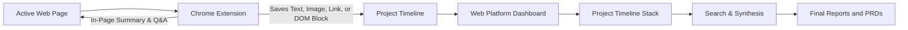
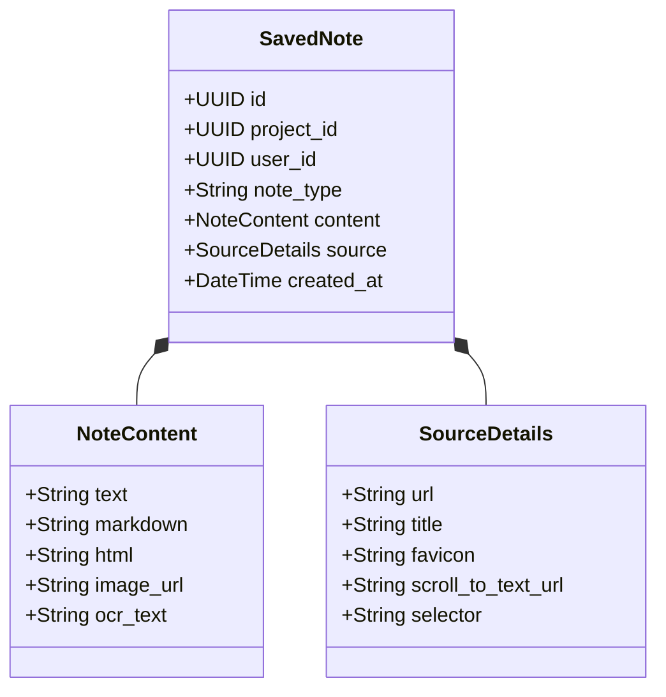

# Product requirements document
## Project: Researchie (Web research extension and project organizer)

Document version: 2.0.0 (rewritten 2026-10-16 to match what was built; the first draft was 1.1.0)  
Status: Built and in hosted testing  
Extension: 1.5.0. App: v1.9.5. Live test site: `researchie-testers.vercel.app`  

## 1. Summary

People who do heavy online research spend a lot of time copying text, saving screenshots, and losing track of what they found across dozens of browser tabs. Standard bookmarks do not save the actual text or visual context, and copying into apps like Google Docs or Notion often breaks tables and formatting. When researchers need to review their sources later, they waste time trying to find the original page and remember why they saved a quote.

Researchie connects two tools to solve this:
1. A Chrome extension (Manifest V3) that lets users save highlighted text, web links, images, and full layout blocks (such as pricing tables and comparison grids) straight into a project. It also provides a quick page summary and lets users ask questions about the current page using AI.
2. A web application where saved items stack up in a clean timeline. Users can search their saved notes using plain language, trace any quote back to the exact sentence on the source page, and generate summary reports across multiple saved clips.

## 2. How researchers work and where they get stuck

We looked at how people gather research across product design, market analysis, venture capital, and academic work.

### Observed workflows

| Role | Primary task | What they collect | Main problem |
| :--- | :--- | :--- | :--- |
| Product and UX designers | Competitive teardowns, pricing audits, pattern benchmarking | UI components, pricing cards, feature tables | Copying breaks formatting; screenshots are just static pictures that cannot be copied or searched. |
| Market and investment analysts | Industry research, earnings notes, press releases | Data tables, financial metrics, executive statements | Hard to organize quotes from 20 different sources into a clear briefing doc. |
| Academic and tech researchers | Reading papers, technical documentation, specifications | Quotes, citations, formulas, API definitions | Quotes lose their context; users cannot easily jump back to the exact sentence in a 30-page paper. |

### The five stages of web research

Most web research follows five steps:
1. Discovery: Opening 15 to 30 tabs from search results, news feeds, and social posts.
2. Collecting: Copying quotes, saving images, or bookmarking links into a temporary doc.
3. Verification: Checking numbers against a second source and noting key takeaways.
4. Organizing: Grouping scattered notes into themes, timelines, or categories.
5. Writing: Drafting the final summary, PRD, memo, or presentation with citations.

Today, people get stuck between steps 2 and 4. Moving back and forth between browser tabs and note apps breaks concentration, and notes quickly turn into an unorganized mess of text.

## 3. The four note types

When a user saves something, Researchie stores it as one of four note types with full source details:

1. Text note: Highlighted text from the page. Researchie saves the text, author, page title, and creates a browser scroll link (`#:~:text=start,end`). Anyone who clicks that link opens the page scrolled and highlighted directly to that quote.
2. Link note: A saved URL that automatically pulls the page title, preview image, description, and an AI-generated one-sentence summary.
3. Image note: A saved image or screen crop. The system runs optical character recognition (OCR) so any text inside charts or diagrams is fully searchable later.
4. Layout block note: A captured section of the webpage (such as a pricing card or comparison table). The user hovers over the block with an element picker to select it. Researchie stores both a clean HTML version and an image snapshot, keeping the visual layout while leaving the text selectable.

## 4. Common user habits and friction points

### Four user behaviors

1. Tab hoarders: Keep 50 to 200 tabs open across multiple windows as a reminder to read them later, fearing they will lose the link if they close the tab.
2. Copy-paste scramblers: Jump constantly between the browser and a Google Doc or Notion page, pasting unformatted text and broken tables.
3. Context losers: Save a quote or metric, but forget which company or article it came from when writing their report a few days later.
4. Overwhelmed collectors: Collect dozens of bookmarks and notes, but struggle to start writing because their notes are not organized.

### Core problems to solve

1. Lost source context: A quote without a date, author, or URL is hard to cite reliably.
2. Tab switching friction: Switching windows to paste a quote takes 4 to 5 seconds each time and interrupts reading.
3. Broken page formatting: Complex elements like pricing grids, multi-column tables, and spec sheets turn into unreadable text when copied.
4. Forgotten bookmarks: Traditional bookmarks sit in a folder and are rarely opened again.
5. Ineffective search: Standard keyword search misses relevant notes when the user searches for a concept using different words than the author used.
6. Reading long pages without assistance: Reading a 10,000-word document without a quick way to ask specific factual questions slows researchers down.

## 5. Jobs to be done

Core job:
"When I am researching a topic across several websites, I want to capture text, images, and layout blocks into a project without leaving the page, so that I have an organized set of notes ready when I write my report."

Supporting jobs:
- Confirm where a specific data point came from without searching through browser history.
- Share an organized stream of research notes with team members.
- Summarize findings across 15 different articles into a single draft.

## 6. Target users

### 1. Product and UX designers
- What they do: Benchmark competitor websites, pricing models, and onboarding flows.
- Pain point: Screenshots do not preserve text, and regular clippers ruin tables.
- Value from Researchie: The block picker captures pricing and feature tables as styled, selectable components.

### 2. Market and investment analysts
- What they do: Gather market size estimates, founder quotes, and customer reviews across news sites and forums.
- Pain point: Hard to remember which source said what when writing an investment memo.
- Value from Researchie: Every text quote links back to the exact paragraph on the live page, and multi-note summaries help assemble the initial draft.

### 3. Academic and deep-tech researchers
- What they do: Read long preprints, technical standards, and documentation.
- Pain point: Finding a specific benchmark across multiple whitepapers is tedious.
- Value from Researchie: In-page Q&A answers specific questions about long articles directly in the browser.

## 7. Feature specifications

What is built is marked as built. What is planned is marked as planned. The build history is in `docs/CHANGELOG.md`; the reasons for each choice are in `docs/DECISIONS.md`.

### Chrome extension (built, version 1.5.0)

#### 1. Selection tools
- Text selection: highlighting text shows a small pill with three icons and nothing between them: Send, a tag, and three dots. Send saves the quote with its surrounding context and a scroll-to-text link. The tag icon adds one tag before sending. The three dots open "Set project". Hovering Send shows which project the clip goes to. Keyboard shortcut: `Alt + S`.
- Link saving: the Link button in the extension popup, or `Alt + L`, saves the page address, title, favicon and description. A confirmation appears in the popup and on the page.
- Image saving: `Alt + I` lets the user hover over any image and click it; `Alt + C` crops part of the screen. Both open the same small dialog with "Set project" and a tag icon.
- Layout block picker: `Alt + B`. Moving the mouse highlights page containers with an outline and the tag name. The Up arrow expands the selection to the parent; the Down arrow selects a child. Clicking opens the same dialog, then saves the cleaned HTML (scripts and iframes removed) with the page's own colors and layout.
- Set project: a small "Set project" label with the chosen project under it, highlighted. The list has no scrollbar. Projects have a blue folder; sub-projects have no icon and hang off a guide line under their project, the same as on the platform. Picking a project confirms with "Set to <project>". The popup, the side panel and the dialogs all show it the same way.
- All dialogs share one look and stay fully inside the window, buttons included.

#### 2. Side panel (Chrome's native `chrome.sidePanel`)
- Page summary: Auto, 3 bullets, Detailed, and Tables. It writes a real summary from the page text, and "Save to Project" puts it in the timeline.
- Page Q&A: the assistant reads the clean text of the active tab. Answers carry clickable citations that scroll the tab to the exact sentence. Any answer can be saved to the project.
- Feed: the project's recent clips, with Jump (open the source in context), delete, and the project switcher.
- Account: a link icon opens the same token panel as the popup, and the status reads "Not connected" until a token is stored.
- Ask AI on a selection was removed from the pill and the dialogs in 1.5.0; the side panel is where questions are asked.

#### 3. Connecting to an account
- The extension connects with a token only. The token ends in the server's address, so there is no server field. In the web app, Profile shows the token with Copy; in the extension, the link icon next to the on/off switch opens a box to paste it. The token is checked with the server before it is kept.
- The extension only trusts https addresses, or http on this computer.
- Without a token nothing is sent: the extension shows "Not connected" with a Connect button, and clips taken meanwhile wait in the offline queue.
- On a local server (no accounts) the token is only a pairing code that carries the address.

#### 4. Offline queue
- If the server cannot be reached, clips wait in browser storage and are sent by themselves every minute, at browser start, and when the browser goes online. A clip the server refuses is marked rejected and is not retried by itself. Each clip carries an id from its first try, so a retry after a lost reply does not save it twice.

### Web application (built)

#### 1. Accounts and the projects dashboard
- Two modes, chosen by the server. With accounts off (local development) there is one demo user and a local file store. With accounts on (the tester deployment) there are real accounts, and each user's data is private.
- Sign-up and sign-in use email and password. Sign-up can require an invite code. Google sign-in is a disabled placeholder until it is set up in Supabase.
- The session is an httpOnly cookie that only the server sets.
- Switch account: the profile menu lists the other email addresses used to sign in on this browser. Picking one signs out and opens the sign-in page with that address filled in. Only addresses are remembered, never passwords.
- Delete account: Settings, then Account & Security. The user sets up an authenticator app once, then deletes with the password, a current code from the app, and the word DELETE. This removes projects, clips, documents, settings, AI keys, extension tokens and the login. Showing a QR code for the set-up is planned.
- The dashboard lists projects, sub-projects, clip counts and recent activity. Deleting a project asks whether to keep its clips and moves them to another project first if the user says so.

#### 2. Workspace views
- Three modes: Feed (a chronological card stream), Spatial Canvas, and Document Reader. Selection persists across sub-projects.
- Text cards open the original page scrolled to the quote. Image cards show the image and searchable OCR text. Block cards switch between the visual snapshot and the clean HTML. Link cards can play YouTube, Vimeo, Dailymotion and Loom links in place. Cards can be tagged and pinned to the top of the feed. Deletes are optimistic with an 8-second undo and a trash drawer.
- Document Reader: users upload PDFs and Word files, read them with text selection and highlights, and ask questions answered with passages and verified citations.

#### 3. Search and synthesis
- Search: exact keyword matching plus conceptual search over saved notes.
- Context finder: reconnects a quote with the surrounding paragraphs from the original page when the page can be fetched.
- Synthesis: select several notes and generate a draft summary, comparison table or outline with a citation for each note.
- Citation engine: resolves DOI, PMID, report numbers and web pages on demand, formats APA 7, AMA, NLM and others, flags retractions and mismatches as warnings, and exports BibTeX and RIS.

#### 4. Export
- Markdown, Obsidian (incremental, using `researchie_atom_id` in frontmatter), Notion (incremental, skipping blocks it already has), BibTeX and a PDF research report built in the browser.

#### 5. AI
- Each user brings their own key (Groq, Cerebras, OpenRouter or Google AI Studio) in Settings. The server checks it with the provider, encrypts it, and shows only the last four characters. A missing or rejected key returns a message and a link, never a made-up answer. Model names are editable because providers rename them.
- With accounts off, a deterministic fallback works without any key so the app and its tests run offline.

### Planned, not built
- Sharing a project with other accounts: a link with can view or can edit, invites by email with a role, a member list, and Request access, all enforced on the server (scope S-54).
- Sign in with Google (S-45); a QR code for the authenticator set-up (S-59); keeping each user's Notion token on the server (S-46); real-time collaboration and two-way Notion sync (provisional).

## 8. Competitor comparison

| Feature | Researchie | Notion Web Clipper | Readwise Reader | Heptabase | Perplexity Companion |
| :--- | :--- | :--- | :--- | :--- | :--- |
| Element block picker | Yes | No (mangles layout) | No | No | No |
| In-page Q&A side panel | Yes | No | No | No | Search only |
| Chronological note stack | Yes | No (flat database) | Read-later list | Visual board | Chat history |
| Exact sentence scroll links | Yes | No | Yes | No | No |
| Cross-note synthesis | Yes | No | Basic | No | Web synthesis only |
| Searchable image OCR | Yes | No | Basic | No | No |

## 9. Development phases and where each stands

### Phase 1: Core extension and timeline — done
- Next.js web application with login and database setup.
- Chrome extension for text and link saving with scroll-to-text links.
- Project timeline showing saved cards in order.

### Phase 2: In-page tools and block picker — done
- Block picker that saves cleaned HTML containers.
- Side panel with page summaries and page Q&A.
- Image and screen-crop clipping with OCR text extraction.

### Phase 3: Search and synthesis — done
- Conceptual search across saved notes, the context finder, and multi-note synthesis.
- Citation engine, verified document Q&A, PDF reader and Spatial Canvas, added beyond the original plan.

### Phase 4: Collaboration and export — export done, collaboration not started
- Export to Markdown, Obsidian, Notion, BibTeX and PDF is built.
- Shared projects for teams are not built (scope S-54). Real-time collaboration is provisional.

### Phase 5: Hosted testing — in progress
- Real accounts, private per-user data, each user's own AI key and the extension token are live at `researchie-testers.vercel.app` for 5 to 10 testers (Vercel Hobby plan, Supabase Postgres).
- Open: live checks of sign-up, uploads and OCR on the hosted site; Google sign-in; the invite code on the live site.

## 10. Pricing model

Not decided. The earlier draft proposed a Free tier (3 projects, 25 block clips a month), a Pro tier ($12 a month) and a Team tier ($25 per user a month). None of these limits is enforced in the product, and enforcing free-plan limits was dropped on 2026-10-14. The app currently has no payments. Pricing will be set after testers have used it.

## 11. Technical stack

- Chrome extension: Manifest V3, plain JavaScript with no build step. The pill and its menus use Shadow DOM so a site's styles cannot leak in. The block, image and screenshot dialogs sit in the page and carry their own styles. A background worker handles saving, the offline queue and the token.
- Web application: Next.js 15.5, React 19, TypeScript, Tailwind CSS 3, Phosphor icons. PDF.js for reading PDFs, Tesseract.js for OCR (the English language file is shipped with the app), JSZip and react-markdown.
- Database: Supabase Postgres with row-level security. On the tester deployment every query is filtered by the signed-in user, and the data layer is unit-tested to show one user cannot read or change another's data. With accounts off, the app uses local JSON files and an in-memory seeded store.
- Search: vectors are computed by a deterministic local method, so search works without an external embedding service.
- AI: pluggable providers behind one chat adapter (Groq, Cerebras, OpenRouter, Google AI Studio). The user's key is encrypted with AES-256-GCM, bound to the user. Document Q&A returns passages with offsets, and links come only from verified citations. The Python graph builder (Cognee scripts) runs locally only.
- Authentication: Supabase Auth, with the session in an httpOnly cookie. The extension uses a token whose SHA-256 hash is stored. Account deletion is confirmed with a time-based one-time code (TOTP) from an authenticator app.
- Hosting: Vercel, uploaded with the Vercel CLI.
- Tests: unit tests (Node test runner) and Playwright end-to-end tests. The extension tests load the real extension into a throwaway Chrome profile.

## 12. Privacy and data security

1. The extension inspects page content only when the user clicks a tool, highlights text or opens the side panel. It does not record form inputs or passwords.
2. Saved HTML blocks have scripts and iframes removed. Pages fetched on the server are refused for local and private addresses.
3. On the tester site each user's projects, clips, documents and settings are private to that user. The session cookie cannot be read by page scripts, and requests that change data from another site are refused.
4. Extension tokens are shown once, and only a hash is stored. A user can revoke tokens.
5. AI keys are stored encrypted and never shown in full again. Secrets are never put in documents, and every push is scanned for them.
6. Users can export all their notes at any time, and can delete their own account and everything in it.
