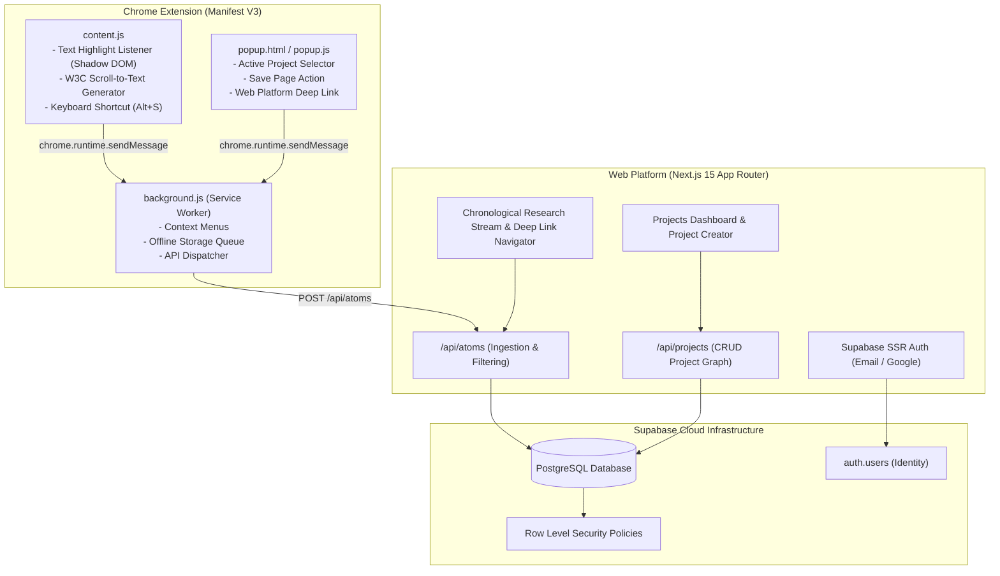
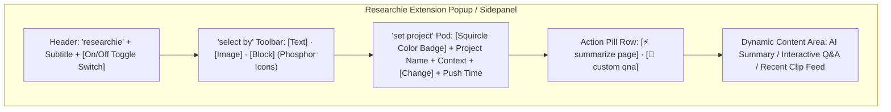

# Design Specification: Researchie Phase 1 MVP

**Topic:** Research Ingestion Extension & Web Knowledge Platform (Phase 1 MVP)  
**Date:** 2026-09-25  
**Status:** Under Review  

---

## 1. Executive Overview

Researchie Phase 1 delivers a zero-friction research clipping loop: capturing text quotes and links from any active browser tab with exact source provenance (W3C Text Fragment deep links), and organizing them into chronological project timelines on a full-stack Next.js web application powered by Supabase Cloud.

---

## 2. System Architecture & Component Topology

---

## 3. Data Schema & Supabase SQL Specification

### 3.1 Table: `profiles`
Links directly to Supabase Auth `auth.users`.
* `id`: `uuid` PRIMARY KEY REFERENCES `auth.users(id)` ON DELETE CASCADE
* `email`: `text` NOT NULL
* `full_name`: `text`
* `created_at`: `timestamptz` DEFAULT `now()`

### 3.2 Table: `projects`
Contains user-defined research subjects / topics.
* `id`: `uuid` PRIMARY KEY DEFAULT `gen_random_uuid()`
* `user_id`: `uuid` NOT NULL REFERENCES `profiles(id)` ON DELETE CASCADE
* `title`: `text` NOT NULL
* `description`: `text` DEFAULT `''`
* `color`: `text` DEFAULT `'#3B82F6'`
* `tags`: `text[]` DEFAULT `'{}'`
* `atom_count`: `integer` DEFAULT 0
* `created_at`: `timestamptz` DEFAULT `now()`
* `updated_at`: `timestamptz` DEFAULT `now()`

### 3.3 Table: `atoms`
Stores atomic research notes (text quotes & link bookmarks).
* `id`: `uuid` PRIMARY KEY DEFAULT `gen_random_uuid()`
* `project_id`: `uuid` NOT NULL REFERENCES `projects(id)` ON DELETE CASCADE
* `user_id`: `uuid` NOT NULL REFERENCES `profiles(id)` ON DELETE CASCADE
* `type`: `text` NOT NULL CHECK (type IN ('text', 'link'))
* `title`: `text` NOT NULL
* `content`: `jsonb` NOT NULL (holds `raw_text`, `markdown_content`, `target_url`, `description`)
* `metadata`: `jsonb` NOT NULL (holds `source_url`, `page_title`, `domain_favicon`, `scroll_to_text_fragment`, `author`)
* `tags`: `text[]` DEFAULT `'{}'`
* `user_notes`: `text` DEFAULT `''`
* `captured_at`: `timestamptz` DEFAULT `now()`

### 3.4 Row Level Security (RLS)
* `profiles`: Users can select and update their own profile (`auth.uid() = id`).
* `projects`: Users can select, insert, update, and delete their own projects (`auth.uid() = user_id`).
* `atoms`: Users can select, insert, update, and delete their own atoms (`auth.uid() = user_id`).

---

## 4. Chrome Extension Functional & UI Specification (Manifest V3)

### 4.1 UI Layout Architecture (From Wireframe)

1. **Header Zone**:
   - Brand title `researchie` (`Space Grotesk` Bold) + Subheading (`Figtree` Muted).
   - Top-right **On/Off Switch** to toggle in-page floating selection pills on the active tab.
2. **'Select by' Tool Strip**:
   - 3 rounded squircle buttons with **Phosphor Icons**:
     - `TextT`: Highlighted text & quote capture (`Alt+S`).
     - `Image`: Screen crop & OCR extraction (`Alt+C`).
     - `Selection` / `SquaresFour`: DOM block container inspector (`Alt+B`).
3. **'Set Project' Active Target Pod**:
   - Section label `set project` with quick `change` modal link.
   - Large 44px rounded squircle color badge, project title, research context description, and live `recent push time` (e.g. `Synced 2m ago`).
4. **In-Situ Action Buttons**:
   - `summarize page`: Generates a structured 3-bullet takeaway of the active tab.
   - `custom qna`: Opens contextual question-and-answer prompt input.
5. **Dynamic Workspace / Output Pod**:
   - Houses the real-time AI summary output, Q&A citation chips, and instant "Save to Project" confirmation.

### 4.2 Core Engines
1. **Isolated Shadow DOM**: Floating capture pill is attached to `#researchie-host` so host webpage CSS never leaks into the UI.
2. **W3C Text Fragment Generator**: Computes deep links (`#:~:text=[start],[end]`) for every captured text quote.
3. **Offline Sync Queue**: Persists clips in `chrome.storage.local` if disconnected.

---

## 5. Web Platform Functional Specification (Next.js 15)

1. **Authentication**:
   * Supabase SSR Auth with Email and Google OAuth login options.
   * Protected routes redirecting unauthenticated users to `/login`.
2. **Projects Dashboard**:
   * Grid view of active research projects with item counts, tags, color pills, and creation date.
   * Modal for creating new projects.
3. **Chronological Timeline Stream**:
   * Reverse-chronological card stream of clips.
   * **"Jump to Quote"** button executing deep-link navigation.
   * 1-click Quote & Markdown citation copier.
   * Filter tabs (All, Quotes, Links) and text search filter.
   * In-app manual clip addition drawer.

---

## 6. Verification & Test Strategy

1. **Automated Schema & API Tests**:
   * Supabase RLS policy tests: verify user A cannot read or write user B's clips.
   * API route tests for `/api/projects` and `/api/atoms`.
   * Unit tests for W3C text fragment generation edge cases.
2. **Manual End-to-End Test**:
   * Log into Web Platform with Supabase.
   * Create a project "AI Inference Benchmarks".
   * Open an external webpage in Chrome $\rightarrow$ highlight paragraph $\rightarrow$ save via pill / `Alt+S`.
   * Verify clip appears in the web timeline stream.
   * Click "Jump to Quote" $\rightarrow$ verify webpage opens scrolled and highlighted to that exact sentence.
