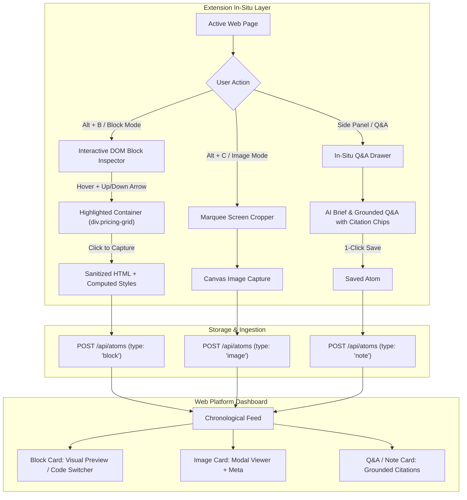

# Researchie — Phase 2 Design Specification: In-Page Tools, DOM Block Picker & AI Q&A

Document version: 2.0.0  
Date: 2026-09-26  
Status: Approved for Build  

---

## 1. Executive Summary & Goals

Phase 2 expands Researchie from single-sentence quote clipping into an **in-situ visual and cognitive research powerhouse**:
1. **Visual DOM Block Picker**: Precision hover element inspector with keyboard tree traversal (<kbd>↑</kbd> to parent container, <kbd>↓</kbd> to child element) that extracts sanitized HTML and DOM layout snapshots (e.g., pricing cards, spec tables, multi-column comparison grids).
2. **Image Clipping & Area Cropping**: Screen area marquee crop (<kbd>Alt+C</kbd>) and image hover grab.
3. **Pluggable AI Integration Layer**: In-situ page summarizer and conversational Q&A side panel with citation chips, ready for Gemini, OpenAI, Claude, or AI Gateway.
4. **Pluggable Storage Layer**: Multi-backend asset storage for screenshot blobs (Supabase Storage, Cloudflare R2, or local data URLs).
5. **Rich Card Renderers on Web Platform**: Interactive HTML component view and high-res image viewers.

---

## 2. User Experience & Interaction Architecture



---

## 3. Detailed Component Specifications

### 3.1 Visual DOM Block Picker (`extension/blockPicker.js`)
- **Inspection Overlay**: Uses isolated pointer events in Shadow DOM.
- **Bounding Box Highlighter**: 2px outline in Electric Lime (`#D2F83C`) with semi-transparent backdrop and a floating tag badge showing tag name, classes, and dimensions (e.g., `div.pricing-card [340x480]`).
- **Keyboard Navigation**:
  - <kbd>↑</kbd> (Arrow Up): Expands current selection to `targetElement.parentElement`.
  - <kbd>↓</kbd> (Arrow Down): Narrows selection to `targetElement.firstElementChild`.
  - <kbd>Esc</kbd>: Exits block inspection mode cleanly without DOM mutations.
- **Sanitizer & Stripper**:
  - Strips `<script>`, `<iframe>`, `<form>`, `<input>`, `<noscript>`, and inline tracking event handlers (`onclick`, `onload`).
  - Preserves layout classes, inline structural styles, tables (`<table>`, `<thead>`, `<tbody>`, `<tr>`, `<th>`, `<td>`), grids, flexboxes, and typography.
- **Snapshot Payload**:
  ```typescript
  {
    type: 'block',
    title: 'Captured DOM Container: table.comparison-grid',
    content: {
      sanitizedHtml: '...',
      rawText: '...',
      description: 'Saved 4-column comparison table'
    },
    metadata: {
      sourceUrl: '...',
      domCssSelector: 'div.main > table.comparison-grid',
      tagName: 'TABLE'
    }
  }
  ```

---

### 3.2 Area Cropper & Image Clipper (`extension/cropper.js`)
- **Marquee Drag Box**: Canvas-based crosshair drag box with semi-transparent dark overlay.
- **Image Hover Pin**: Hovering over large `` tags shows a floating 1-click "Save Image to Researchie" badge.
- **Image Payload**:
  ```typescript
  {
    type: 'image',
    title: 'Chart / Diagram Capture',
    content: {
      imageUrl: 'data:image/png;base64,...',
      description: 'Captured screen crop'
    },
    metadata: {
      sourceUrl: '...',
      pageTitle: '...'
    }
  }
  ```

---

### 3.3 Pluggable AI Service Adapter (`src/lib/ai/`)
- Abstract interface `AIService`:
  ```typescript
  export interface AIService {
    summarizePage(pageText: string, pageTitle: string): Promise<{
      bulletTakeaways: string[];
      summary: string;
    }>;
    askPageQuestion(pageText: string, question: string): Promise<{
      answer: string;
      citations: Array<{ quote: string; textFragment: string }>;
    }>;
  }
  ```
- Modular adapters:
  - `GeminiAdapter`: Connects directly to Google Gemini 1.5 Flash.
  - `OpenAIAdapter`: Connects to GPT-4o / GPT-4o-mini.
  - `GatewayAdapter`: Connects via Vercel AI Gateway (default fallback when `AI_GATEWAY_API_KEY` is present).
  - `MockAIAdapter`: Fast deterministic fallback for offline / development testing without API keys.

---

### 3.4 In-Situ AI Q&A Drawer (`extension/sidepanel.html` & `extension/qnaDrawer.js`)
- Embedded directly in the host page (Shadow DOM) or via Chrome Side Panel API.
- Reads cleaned page text (`document.body.innerText`).
- Generates 3 key bullet points in under 2 seconds.
- Interactive question box with instant response streaming.
- Clickable citation chips jump to source text.
- 1-click "Save Answer to Project" button.

---

### 3.5 Web Platform Block & Image Card Renderers (`src/components/`)
- `BlockAtomRenderer.tsx`: Dual-tab card:
  - **Visual Tab**: Sandboxed shadow iframe rendering the preserved HTML table/grid layout with responsive bounds.
  - **Code Tab**: Clean formatted HTML/JSX markup with 1-click "Copy Code".
- `ImageAtomRenderer.tsx`: High-resolution modal preview with 1-click download and deep link back to page context.

---

## 4. Phased Implementation Milestones

1. **Milestone 1**: Pluggable AI & Storage Adapter Infrastructure in `src/lib/`.
2. **Milestone 2**: In-Situ Visual DOM Block Picker with Keyboard Navigation & Sanitizer.
3. **Milestone 3**: Screen Marquee Area Cropper & Image Ingestion.
4. **Milestone 4**: In-Situ AI Q&A Drawer & Page Summarizer API.
5. **Milestone 5**: Web Platform Rich Card Renderers (`BlockAtomRenderer`, `ImageAtomRenderer`).
6. **Milestone 6**: End-to-End Build & Live Ingestion Verification.
